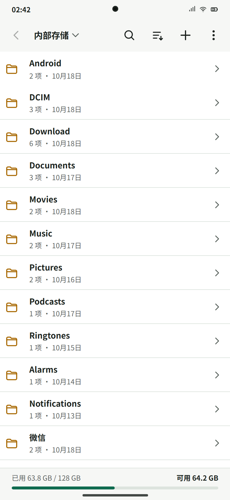

# Zippest

Zippest is an Android file manager and archive utility for browsing, extracting,
and creating common compressed formats. Its interaction model follows the
familiar flow of ZArchiver and RAR for Android while using Android's Storage
Access Framework for scoped folder access.



## Repository layout

- `android/` - Kotlin and Jetpack Compose Android application
- `design/` - frozen interactive product prototype and reference screenshots
- `tools/` - local test fixtures and automation scripts

## Highlights

- Browse authorized folders, search, sort, create folders, copy, move, share,
  rename, and delete.
- Request Android's all-files access for direct internal-storage browsing, with
  a scoped SAF folder picker as fallback.
- Configure theme, hidden files, thumbnails, sorting, persistent extraction
  defaults, clipboard password fill, notifications, and task maintenance.
- Browse ZIP, 7Z, RAR, TAR, TAR.GZ, TAR.BZ2, TAR.XZ, TAR.ZST, TAR.BR,
  CPIO, GZ, BZ2, XZ, LZMA, LZ4, ZST, and BR.
- Create ZIP, 7Z, TAR, TAR.GZ, TAR.BZ2, TAR.XZ, TAR.ZST, CPIO, GZ, BZ2,
  XZ, LZMA, LZ4, and ZST archives with selectable compression levels.
- Create password-protected ZIP and 7Z archives.
- Split any supported created archive into `.001`, `.002`, and later volumes;
  open the first volume in Zippest to combine and extract it.
- Extract to the archive folder, a new same-name folder, or any SAF folder.
- Open password-protected ZIP, 7Z, and RAR archives.
- Unlock encrypted 7Z and RAR headers directly in the archive browser.
- Reuse one password across a multi-archive job or enter each password
  separately.
- Queue extraction and compression through WorkManager with persistent notification progress
  and recovery after the app process is stopped.
- Keep active archive jobs running with a foreground service and partial CPU wake lock
  while the app is in the background or the screen is off.
- Show a live archive-task card and progress bar in place of the storage bar.
- Preselect a renamed file's suffix and provide 7Z, ZIP, RAR, and custom suffix shortcuts.
- Choose copy and move destinations inside Zippest instead of leaving the app for
  Android's document picker.
- Route modifications through direct file-system APIs whenever all-files access is
  granted, including standard internal-storage folders opened through SAF.
- Delete files immediately without an extra app confirmation.
- Move deleted files into a persistent recycle bin with restore, permanent delete,
  empty-trash, and configurable retention controls.
- Show compact operation notices in the center of the app instead of the bottom edge.
- Paste the current clipboard text directly from the extraction clipboard row while
  keeping the expand control separate.
- Remove the duplicated root path subtitle and present fixed storage locations as
  an icon-based quick-location grid.
- Open extraction directly when tapping an archive, and reserve the trailing chevron
  for archive preview. Preview mode uses an animated border and explicit extraction hint.
- Tapping a file inside preview opens extraction settings for the complete archive.
- Create native ZIP volumes as `.z01/.z02/.../.zip`, and open either `.z01` or the
  final `.zip`; numeric `.zip.001` volume sets remain readable.
- Notify Android's media index when extraction writes images or videos directly
  into shared storage.
- Encrypt queued archive passwords with an Android Keystore-managed key.
- Inspect active, queued, and completed jobs from the in-app task center.
- Run a real integrity test that reads every archive entry.
- Open archives through Android's standard "Open with" flow.
- Guard against path traversal, archive bombs, excessive entry counts, and
  insufficient disk space.

## Build

```powershell
cd android
$env:JAVA_HOME='C:\Android Studio\jbr'
.\gradlew.bat assembleDebug
.\gradlew.bat lintDebug
.\gradlew.bat assembleRelease
.\gradlew.bat bundleRelease
```

The signed release APK is generated at:

```text
android/app/build/outputs/apk/release/app-release.apk
```

Android Studio can open `android/` directly.

Release signing is loaded from the local, Git-ignored `.signing/` directory.
Back up both the keystore and its properties file before publishing future
updates.

## Status

The package name remains `com.decompress.app` for upgrade compatibility.
Version `1.5.1` moves compression into the selection menu and presents
extraction as a circular action above the selection toolbar.
Version `1.5.0` added archive renaming and suffix shortcuts directly to the
single-archive extraction sheet; the rename is committed before extraction.
Version `1.4.4` added matching linear icons to the selection-toolbar menu.
Version `1.4.3` positioned top and bottom menus directly from the visible
Scaffold bar boundaries instead of popup icon anchors, then lifts and narrows
the resulting compact panels. Version `1.4.0` aligned top-bar and selection-toolbar
menus flush with their adjacent app bars. Version `1.3.8` aligned top-bar dropdowns beneath the anchor
icon, removed menu shadows, and retained the full theme-colored border.
Version `1.3.5` aligned top-bar dropdowns beneath the app bar and used
the active theme background for every menu surface. Version `1.3.2` unified
every dropdown menu with the rounded, elevated panel style used by the
internal-storage chooser. Version `1.3.1` replaced the selected-items
share shortcut with a menu containing Open With and Share. Version `1.3.0` opened indexed media through MediaStore and
includes same-folder media URIs so capable galleries and players can navigate
between siblings; write grants enable direct editing where supported.
Version `1.2.4` grouped Open With targets by file type, prioritized direct
viewers/editors ahead of share and send targets, and remembered always-use
preferences for the selected file family. Version `1.2.2` added the
explicit one-time/always Open With dialog and its reset control. Version `1.2.0`
added system-app opening for regular files, cross-volume file
transfer roots, app-wide archive progress with pause/resume and timing, edge and
bottom navigation gestures, Zstandard creation/opening, and Brotli opening.
Version `1.1.9` showed the current directory path as the top-bar title without a
second subtitle and removed the redundant quick-location heading. Version
`1.1.8` removed the colored background tiles from file and folder icons so file
names remain the visual focus. Version `1.1.7` attached the full-width
internal-storage quick-location panel directly below the top app bar. Version
`1.1.6` added native ZIP split-volume output and reading for `.z01/.zip`
sets while retaining numeric `.001` volume support. It opens whole-archive extraction when a previewed file is tapped. It separates direct extraction from archive preview and marks preview mode with an animated border. It redesigns the internal-storage location picker as a compact grid and removes its duplicate root subtitle. It separates direct clipboard paste from the clipboard expansion control in the extraction sheet. It centers compact operation notices across every screen and includes a persistent recycle bin with restore and retention settings, plus unrestricted direct file modifications across standard internal
storage and removes delete confirmation prompts. It includes an in-app destination browser for copy and move operations.
It includes the dot in automatic suffix selection and one-tap 7Z/ZIP/RAR/custom
extension replacement in the rename dialog. It retains screen-off background execution safeguards and an in-app floating
progress bar for active archive tasks. It retains archive creation, password-protected ZIP/7Z output,
split-volume output and reading, plus LZMA/LZ4 support. It retains persistent app settings, theme selection, browsing
preferences, configurable extraction defaults, permission status controls,
and notification/task maintenance. It includes persistent
extraction queues, RAR4/RAR5 support, task status UI, resumable checkpoints,
password-protected archive browsing, and built-in integrity testing.
