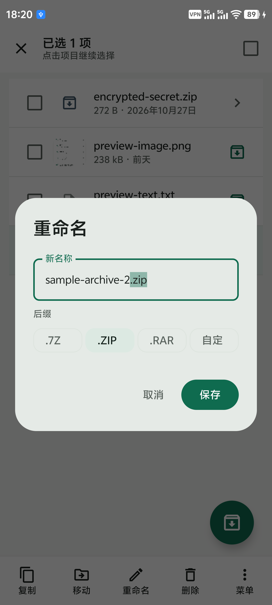
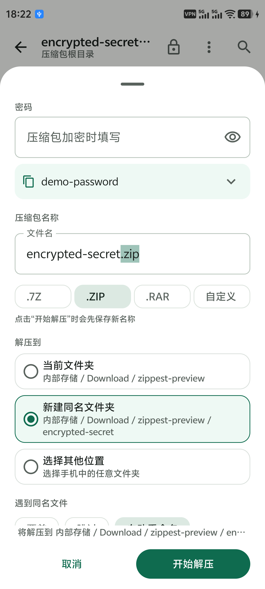
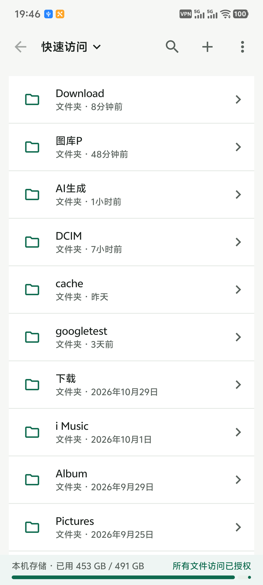

# Zippest

**改后缀不用删名字，解压十个加密包只填一次密码。手机上的压缩包工具：平时不联网，无广告、无账号。**

重命名时 Zippest 会自动选中 `.` 后面的后缀，点一下就能换成 `.7z` / `.zip` / `.rar`，不用先把文件名删掉重打。
解压加密包时，密码框下面直接列出剪贴板里的密码，点一下就填入；多个包一起解压，勾上「使用相同密码」，填一次就够。

<p align="center">
  
  
  
</p>

## 两个最省事的小功能

### 改后缀：点一下就换

- 打开重命名，`.` 后面的后缀自动高亮——直接打字就替换后缀，不会手滑删掉文件名
- 旁边四个快捷键：`.7Z`、`.ZIP`、`.RAR`、自定
- 解压弹窗里也能先改包名和后缀再解压，不用退出去重来

### 填密码：剪贴板直接可用，多包只填一次

- 密码框下面直接出现剪贴板里的内容，点一下填入，不用长按粘贴
- 多个加密包一起解压时，勾「使用相同密码」，填一次应用到整批
- 不同密码的包也可以取消勾选，逐个输入
- AES-256 的 ZIP、头部加密的 7Z、RAR 都支持

## 它还能做什么

**点开就看，只解你要的**
- ZIP、7Z、RAR、TAR 系列直接浏览，不用先解压
- 点包里的文件，只解这一个，交给系统应用打开
- 长按多选，只解选中的几个，不用把几 GB 全倒出来

**文件管理**
- 直接浏览内部存储、SD 卡和 U 盘，不用每次选目录
- 搜索可分「当前文件夹 / 全部存储」，结果带所在路径
- 长按多选：复制、移动、重命名、删除、分享、压缩、解压
- 删除默认进回收站，可恢复；保留期 7 / 30 / 90 天或永久

**压缩与解压**
- 解压 17 种格式，压缩 12 种（含 Zstd、Brotli、LZ4、XZ、7Z、TAR 系列）
- RAR 只解不压——RAR 的压缩算法不允许第三方实现
- 分卷：`.001` / `.z01` / `.part1.rar` 自动收卷，点第一个文件就能解
- 文件名乱码可以切 GBK / UTF-8，不用回设置里翻
- TAR 系列压缩到一半被系统杀掉，下次打开从断点继续

**任务**
- 后台排队，熄屏也继续
- 任务中心可暂停、继续、取消；进度通知展开就能操作
- 完成时点通知或页面提示，直接跳到结果文件夹

> 说明：ZIP / 7Z 的目录信息写在文件末尾，中断后需要重新压缩。

## 安装

到 [Releases](https://github.com/Tnomlav/Zippest/releases) 下载最新的 `arm64-v8a` 安装包；不确定机型就下 `universal`。

- 系统要求：Android 8.0（API 26）及以上
- 安装包约 4.6 MB（arm64 单包）
- 发布包签名一致，可以直接覆盖升级

## 隐私

「所有文件访问权限」的用途、降级路径与商店文案见 [docs/play-store-all-files-access.md](docs/play-store-all-files-access.md)。

- 应用平时不联网；只有你点按「版本号」检查更新时才访问 GitHub Releases API，不含广告、追踪或统计 SDK
- 文件、文件名和密码都只在本机处理
- 可在「系统设置 → 应用 → Zippest → 权限」里查看网络权限的使用

详见 [隐私政策](PRIVACY.md)。

## 从源码构建

```powershell
cd android
$env:JAVA_HOME='C:\Android Studio\jbr'
.\gradlew.bat assembleDebug
.\gradlew.bat assembleRelease                   # arm64 / v7a / universal 三个包
.\gradlew.bat -PzippestBundle bundleRelease     # AAB
.\gradlew.bat -PzippestEmulator assembleDebug   # 模拟器用 x86_64 调试包
```

发布签名配置放在本地 `.signing/`（不纳入 Git）。打 `v*` tag 会触发 GitHub Actions 自动构建、签名校验并发版。

## 许可

项目代码以 [Apache-2.0](LICENSE) 发布；第三方组件许可见 [THIRD_PARTY_NOTICES.md](THIRD_PARTY_NOTICES.md)。
