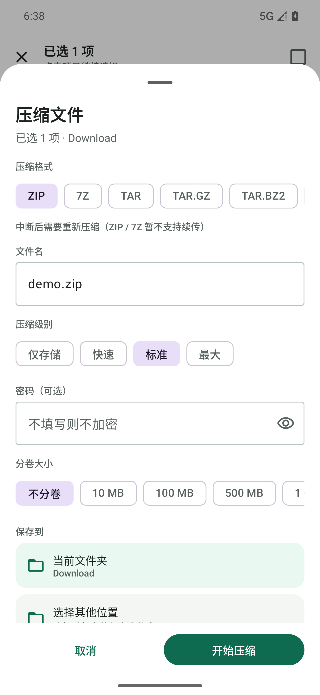
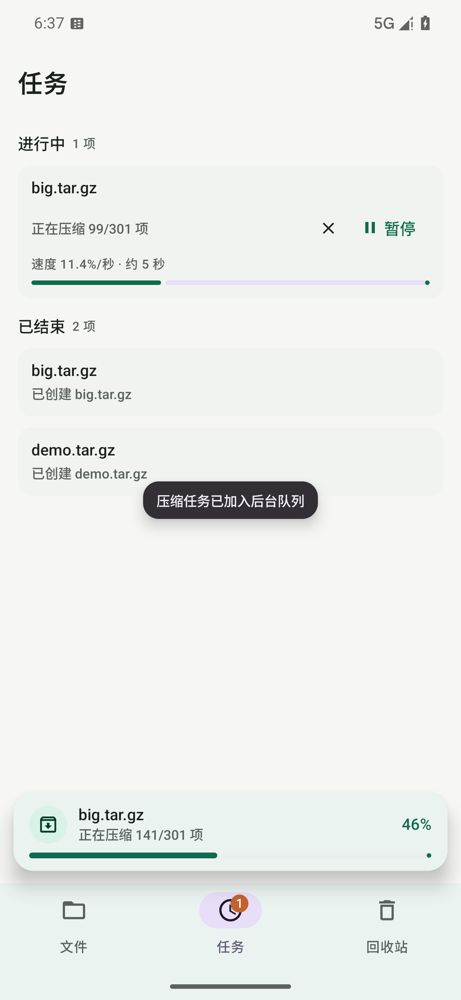

# Zippest

**手机上的压缩包工具：点开就能看，只解你要的，压到一半断了也能接着来。不联网、无广告、无账号。**

你收到一个压缩包想先看看里面有什么——Zippest 点开就能浏览，不用先解压。
只想拿其中一个文件，也不用把整个包解开。
压缩到一半手机把应用关掉了，重新打开会从断点接着压。
全程不连网，文件不出手机。

<p align="center">
  
  
  
</p>

## 四个最不用学的功能

- **点开就看**：ZIP、7Z、RAR、TAR 系列直接浏览；点里面的文件，只解这一个，用系统应用打开。
- **只解你要的**：包里长按多选，只解选中的几个，不用把几 GB 全倒出来。
- **断了能接**：TAR / TAR.GZ / TAR.BZ2 / TAR.XZ 压缩到一半被系统杀掉，下次打开从断点继续。
- **干干净净**：不申请联网权限，没有广告，不用注册，也没有统计 SDK。

## 它还能做什么

**文件管理**
- 直接浏览内部存储、SD 卡和 U 盘，不用每次选目录
- 搜索可分「当前文件夹 / 全部存储」，结果带所在路径
- 长按多选：复制、移动、重命名、删除、分享、压缩、解压
- 删除默认进回收站，可恢复；保留期 7 / 30 / 90 天或永久

**压缩与解压**
- 解压 17 种格式，压缩 12 种（含 Zstd、Brotli、LZ4、XZ、7Z、TAR 系列）
- RAR 只解不压——RAR 的压缩算法不允许第三方实现
- 分卷：`.001` / `.z01` / `.part1.rar` 自动收卷，点第一个文件就能解
- 加密 ZIP（AES-256）和 7Z（含头部加密）
- 一次给多个压缩包填同一个密码；解压前就能改包名和后缀
- 文件名乱码可以切 GBK / UTF-8，不用回设置里翻

**任务**
- 后台排队，熄屏也继续
- 任务中心可暂停、继续、取消；进度通知展开就能操作
- 完成时点通知或页面提示，直接跳到结果文件夹

> 说明：ZIP / 7Z 的目录信息写在文件末尾，中断后需要重新压缩；目前只有 TAR 系列支持断点续传。

## 安装

到 [Releases](https://github.com/Tnomlav/Zippest/releases) 下载最新的 `arm64-v8a` 安装包；不确定机型就下 `universal`。

- 系统要求：Android 8.0（API 26）及以上
- 安装包约 4.6 MB（arm64 单包）
- 发布包签名一致，可以直接覆盖升级

## 隐私

- 应用**没有申请 `INTERNET` 权限**，也不含广告、追踪或统计 SDK
- 文件、文件名和密码都只在本机处理
- 可在「系统设置 → 应用 → Zippest → 权限」里核实没有网络权限

详见 [隐私政策](PRIVACY.md)。

## 从源码构建

```powershell
cd android
$env:JAVA_HOME='C:\Android Studio\jbr'
.\gradlew.bat assembleDebug
.\gradlew.bat assembleRelease                   # arm64 / v7a / universal 三个包
.\gradlew.bat -PzippestBundle bundleRelease     # AAB
.\gradlew.bat -PzippestEmulator assembleDebug   # 模拟器用 x86_64 调试包
```

发布签名配置放在本地 `.signing/`（不纳入 Git）。打 `v*` tag 会触发 GitHub Actions 自动构建、签名校验并发版。

## 许可

项目代码以 [Apache-2.0](LICENSE) 发布；第三方组件许可见 [THIRD_PARTY_NOTICES.md](THIRD_PARTY_NOTICES.md)。
