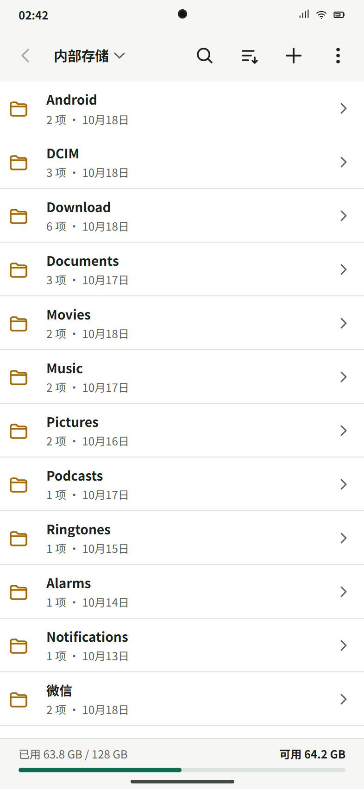

# Zippest

Zippest 最独特的两项能力是便捷的后缀重命名与批量密码填充：重命名时会自动
选中最后一个点及其后的后缀，并提供 7Z、ZIP、RAR 和自定义后缀快捷替换；
批量解压多个压缩包时可启用“使用相同密码”，一次填写后自动应用到整个任务，
无需逐个输入。在此基础上，Zippest 还把文件管理、压缩、解压和删除整合成
不跳转系统文件管理器的连续工作流，支持复制或移动后停留在目标文件夹、熄屏
和后台继续处理、实时进度浮窗、任务暂停与恢复、持久回收站及分卷操作。



## 项目结构

- `android/`：使用 Kotlin 和 Jetpack Compose 开发的 Android 应用
- `design/`：产品原型、图标和界面参考图
- `tools/`：本地测试素材与自动化脚本

## 主要功能

### 文件管理

- 浏览本地文件和文件夹，支持搜索、排序、新建目录、重命名和下拉刷新。
- 长按进入多选，可复制、移动、分享、压缩、解压、删除及查看打开方式。
- 复制和移动直接在当前文件页选择目标目录，完成后停留在目标文件夹。
- 删除前显示一次确认，默认移入回收站，可从文件页菜单恢复或永久删除。
- 支持直接内部存储访问，也保留 Android Storage Access Framework
  文件夹授权作为兼容方案。
- 内部存储快捷位置支持通过系统文件管理器新建、改址和删除。

### 压缩与解压

- 浏览并解压 ZIP、7Z、RAR、TAR、TAR.GZ、TAR.BZ2、TAR.XZ、
  TAR.ZST、TAR.BR、CPIO、GZ、BZ2、XZ、LZMA、LZ4、ZST 和 BR。
- 创建 ZIP、7Z、TAR 系列、CPIO、GZ、BZ2、XZ、LZMA、LZ4 和 ZST
  压缩包，并可选择压缩级别。
- 创建带密码的 ZIP 和 7Z 压缩包。
- 将支持的压缩包分卷为 `.001`、`.002` 等格式，或创建
  `.z01`、`.z02`、`.zip` 分卷集合。
- 打开分卷压缩包的第一个文件时，会自动读取同目录中的全部后续分卷；
  支持数字分卷、`.partN.rar`、`.000.rar`、RAR5 以及旧式 `.rar/.r00`。
- 打开 ZIP、7Z 和 RAR 密码压缩包，并支持加密 7Z、RAR 头部解锁。
- 多压缩包任务可复用同一密码，也可逐个输入密码。
- 解压前可直接修改压缩包名称和后缀，支持 7Z、ZIP、RAR 与自定义后缀。
- 解压预览使用边框特效区分预览内容，点击预览文件可进入完整解压设置。
- 支持完整性检查，并防止路径穿越、异常条目数量和磁盘空间不足等问题。

### 后台任务

- 使用 WorkManager 排队执行压缩和解压任务。
- 应用进入后台或屏幕熄灭后，任务可继续运行。
- 提供常驻通知、应用内任务中心和浮动进度条。
- 支持暂停、继续、取消与恢复检查点。
- 队列密码使用 Android Keystore 管理的密钥加密。

### 界面与系统集成

- 支持系统主题、手动浅色和深色主题。
- 图片和视频显示缩略图，普通文件支持调用系统应用打开。
- 打开方式优先展示查看器和编辑器，其次才是分享或发送类应用。
- 相册和播放器应用打开媒体时，可访问同文件夹内的其他媒体。
- 文件菜单、排序菜单、内部存储面板和选择菜单采用互斥显示。
- 支持 Android 分享、文件关联和“用 Zippest 打开”流程。

## 构建

```powershell
cd android
$env:JAVA_HOME='C:\Android Studio\jbr'
.\gradlew.bat assembleDebug
.\gradlew.bat lintDebug
.\gradlew.bat assembleRelease
.\gradlew.bat bundleRelease
```

签名后的 Release APK 输出位置：

```text
android/app/build/outputs/apk/release/app-release.apk
```

可以直接使用 Android Studio 打开 `android/` 目录。发布签名配置位于本地、
不纳入 Git 的 `.signing/` 目录，发布前应同时备份密钥库及其配置。

## 当前版本

当前版本为 `1.5.18`，包名继续使用 `com.decompress.app`，以保持已有版本升级
兼容性。

此版本让密码输入框使用普通文本键盘，从而保留输入法自带的剪贴板与粘贴入口，
并实时监听系统剪贴板变化。应用不会读取输入法私有的剪贴板历史。

此版本补全了“关于”页面，提供应用信息、完整隐私政策、第三方开源许可和
GitHub 项目入口。

此版本将文件页顶栏中的内部存储路径前缀改为“快速访问”，快速访问面板中的
根快捷项仍保持“内部存储”，并与其他快捷入口使用相同的单格尺寸。

此版本将快捷位置入口命名为“快速访问”，根快捷项改为“内部存储”，并在手机
接入 SD 卡或 USB 存储设备时动态显示可实际打开的外部存储入口。

此版本支持读取并展示剪贴板中的多个文本条目，同时允许普通文件直接打开解压
设置并在解压前修改后缀。

此版本统一了删除确认弹窗的样式：显示删除数量，并提供标准的“取消”和警示色
“确认”操作。

完整版本历史与安装包请查看：

https://github.com/Tnomlav/Zippest/releases

## 隐私与许可

- [隐私政策](PRIVACY.md)
- [第三方开源许可](THIRD_PARTY_NOTICES.md)
